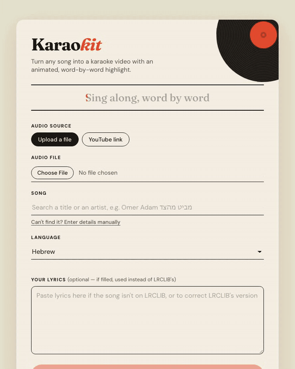

# Karaokit

Turn any song into a karaoke video: the vocals are removed, the lyrics are timed word by word,
and each word lights up as it's sung. Works with Hebrew, Arabic (right-to-left), English,
French, Spanish and Russian.



▶ [Watch the resulting karaoke video with sound](docs/demo/karaoke-one-cute-leash.mp4) (36 s)

<sub>Demo song: "One Cute Leash" by [Geoff Peters](https://ccmixter.org/people/geoffpeters)
([ccmixter.org/files/geoffpeters/58766](https://ccmixter.org/files/geoffpeters/58766)),
licensed [CC BY 3.0](https://creativecommons.org/licenses/by/3.0/). Modified by Karaokit:
vocals removed, lyrics added as an on-screen karaoke highlight. The 54 s of processing are
sped up in the animation.</sub>

You run Karaokit on your own computer and open it in your browser. You give it a song, either
by uploading an audio file or, if you turn the option on, from a YouTube link. You pick the song
in the search box so its lyrics are found, and you get back:

- a `.mkv` video (720p) with the lyrics highlighted word by word, the instrumental as the main
  audio track and the isolated vocals as a second track;
- a "Your videos" library of everything you've made.

## How it works

| Step | Tool |
|---|---|
| Vocals / instrumental separation | [audio-separator](https://github.com/nomadkaraoke/python-audio-separator) with a BS-Roformer model, on a GPU via [Modal](https://modal.com) or on your own computer |
| Lyrics | [LRCLIB](https://lrclib.net), a free, open lyrics database (no account needed) |
| Word-by-word timing | [ctc-forced-aligner](https://github.com/MahmoudAshraf97/ctc-forced-aligner) (Meta MMS) |
| Video | Pillow + ffmpeg + MKVToolNix |

## Quick start (Docker)

You need [Docker](https://docs.docker.com/get-docker/).

```bash
git clone https://github.com/ElieInbar/karaokit.git
cd karaokit
cp .env.example .env
docker compose up --build
```

Then open <http://127.0.0.1:8000>.

Out of the box this runs in **local mode**: no account needed, but separating the vocals takes
about 10-15 minutes per song on a typical computer. For songs in under a minute, set up Modal.

## Fast mode: your own Modal account

[Modal](https://modal.com) runs the heavy part (vocal separation and the alignment's acoustic
model) on a cloud GPU, in **your** account: you pay for what you use, and nothing goes through
anyone else's servers. Modal charges per second of GPU time; check
[modal.com/pricing](https://modal.com/pricing) for current prices and any free credits.

1. Create an account on [modal.com](https://modal.com) (a payment method is required for GPUs).
2. Create an API token in the Modal dashboard (Settings > API Tokens) and put it in `.env`:
   ```
   MODAL_TOKEN_ID=ak-...
   MODAL_TOKEN_SECRET=as-...
   ```
3. Deploy the GPU function to your account, once (and again after updating Karaokit):
   ```bash
   docker compose run --rm karaokit modal deploy deploy/modal_app.py
   ```
4. Restart: `docker compose up`. With `KARAOKIT_SEPARATION=auto` (the default), Karaokit
   uses Modal as soon as credentials are configured.

The first song after a while takes ~20 s longer while Modal starts a GPU container.

## Configuration

All settings go in `.env` (see [`.env.example`](.env.example)):

| Setting | Default | Meaning |
|---|---|---|
| `KARAOKIT_SEPARATION` | `auto` | `modal`, `local`, or `auto` (Modal if credentials are set) |
| `MODAL_TOKEN_ID` / `MODAL_TOKEN_SECRET` | | Your Modal API token |
| `KARAOKIT_ENABLE_YOUTUBE` | `0` | Allow YouTube links as the audio source (see below) |
| `KARAOKIT_DATA_DIR` | project folder (`/data` in Docker) | Where songs are processed and videos kept |
| `KARAOKIT_HOMEPAGE` | | Your project URL, sent to LRCLIB to identify the app |
| `KARAOKIT_FONT_PATH` | bundled fonts | A different font for the video |

## YouTube links (off by default)

Karaokit can download a song's audio from a YouTube link (with
[yt-dlp](https://github.com/yt-dlp/yt-dlp)). Downloading from YouTube is against
[YouTube's Terms of Service](https://www.youtube.com/t/terms), so this is **disabled by
default**. Set `KARAOKIT_ENABLE_YOUTUBE=1` only if you accept that for your own use. YouTube
also temporarily blocks computers that download a lot ("confirm you're not a bot").

## Lyrics and copyright

Songs and lyrics are protected by copyright. Karaokit is a tool for personal use: it doesn't
host or share anything, and the videos you make stay on your computer. Publishing or
distributing videos made from songs you don't own the rights to may require permission from
the rights holders (e.g. ACUM in Israel).

If a song isn't on LRCLIB, you can paste its lyrics yourself. Hebrew titles are sometimes
spelled differently (with or without an extra י or ו) - try both spellings in the search box.

## Running without Docker

Requires Python 3.12, `ffmpeg` and MKVToolNix (`mkvmerge`). On macOS:
`brew install ffmpeg mkvtoolnix`.

```bash
python3.12 -m venv .venv
.venv/bin/python -m pip install -e ".[dev]"
cp .env.example .env
.venv/bin/uvicorn karaoke_he.web.app:app --host 127.0.0.1 --port 8000
```

Run the tests with `.venv/bin/python -m pytest`.

## Credits

- Lyrics: [LRCLIB](https://lrclib.net)
- Separation model: BS-Roformer via [audio-separator](https://github.com/nomadkaraoke/python-audio-separator)
- Alignment: [ctc-forced-aligner](https://github.com/MahmoudAshraf97/ctc-forced-aligner) / Meta MMS
- Fonts: [Rubik](https://fonts.google.com/specimen/Rubik) and
  [Noto Sans Arabic](https://fonts.google.com/noto/specimen/Noto+Sans+Arabic), SIL Open Font
  License (see `src/karaoke_he/assets/fonts/`)

## License

The code is released under the [MIT License](LICENSE). The bundled fonts keep their own
license (SIL Open Font License, see `src/karaoke_he/assets/fonts/`), and the demo song keeps
its CC BY 3.0 license (see above). Karaokit's license covers the code only, not the songs or
lyrics you use it with.

